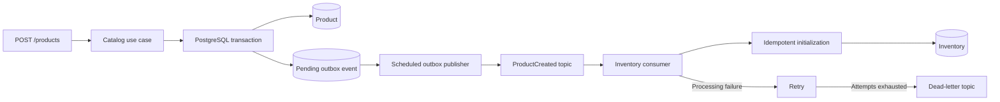

# Lumera Store API

A store backend built with **Java 25, Spring Boot, PostgreSQL, and Apache Kafka**. The project explores modular architecture, business rules, concurrency control, and reliable asynchronous communication through a product catalog and inventory system.

A product is saved together with an outbox event. A background publisher sends the event to Kafka, and the inventory consumer initializes its stock without resetting existing quantities on repeated delivery.

## Features

### Catalog

- Create products with a name, description, price, and category.
- Find products by ID and update their details.
- Activate or deactivate products.
- List products with pagination and optional category and active-status filters.
- Record a `ProductCreated` event in the same database transaction as the product.

### Inventory

- Initialize inventory through the API or automatically through Kafka.
- Query total, reserved, and available quantities.
- Add stock, reserve units, release reservations, and confirm reserved stock withdrawal.
- Preserve existing quantities when initialization is repeated.
- Protect stock movements with pessimistic row locking.

### Reliability and testing

- Transactional Outbox with batch publishing and `FOR UPDATE SKIP LOCKED`.
- At-least-once delivery with idempotent inventory initialization.
- Consumer retries and a dead-letter topic (DLT).
- Centralized HTTP errors using `ProblemDetail`.
- Versioned database migrations with Flyway.
- Unit, web-layer, integration, and concurrency tests using JUnit, Mockito, and Testcontainers.

## Technology stack

| Technology | Purpose |
|---|---|
| Java 25 | Application language and runtime |
| Spring Boot 4.1.2 | Application framework |
| Gradle Wrapper | Build and dependency management |
| Spring Web MVC and Validation | REST endpoints and input validation |
| Spring Data JPA / Hibernate | Persistence and locking |
| PostgreSQL 17 | Relational database |
| Flyway | Database migrations |
| Apache Kafka 4.1.2 / Spring Kafka | Event publication and consumption |
| Jackson 3 | JSON serialization |
| Lombok | Constructor and accessor generation |
| springdoc-openapi | OpenAPI documentation and Swagger UI |
| Podman and Compose | Local infrastructure |
| Testcontainers | Isolated PostgreSQL and Kafka integration tests |

## Architecture

The application is a **modular monolith** organized by business capability. Each module follows a hexagonal structure with domain objects, application use cases and ports, and infrastructure adapters.

```text
catalog/                          inventory/
├── domain/                      ├── domain/
├── application/                 ├── application/
│   ├── event/                   │   ├── command/
│   ├── port/in/                 │   ├── port/in/
│   ├── port/out/                │   ├── port/out/
│   └── service/                 │   └── service/
└── adapter/                     └── adapter/
    ├── in/web/                      ├── in/web/
    ├── out/persistence/             ├── in/messaging/
    └── out/messaging/               └── out/persistence/
```

Domain objects enforce business rules without depending on Spring, JPA, or Kafka. Application services coordinate operations through ports. The application layer uses Spring annotations for dependency injection and transaction boundaries.

### Product-to-inventory flow



The publisher marks an event as published only after Kafka acknowledges the send. If Kafka acknowledges a message but the database transaction rolls back, the message can be sent again with the same event ID. Inventory initialization handles this by creating stock only when no record exists for that product.

Database commits and Kafka offset commits are separate. The system relies on idempotency rather than claiming exactly-once processing across both systems.

## Getting started

### Prerequisites

- JDK 25.
- Podman with a Compose provider available through `podman compose`.
- A running Podman machine on macOS.
- Ports `5432`, `9092`, and `8080` available. Optional browser tools use `8081` and `5050`.

Gradle is provided by the repository wrapper.

### 1. Clone the repository

```bash
git clone https://github.com/beatrizsousaanjosdev/lumera-store.git
cd lumera-store
```

### 2. Start PostgreSQL and Kafka

On macOS, start your Podman machine if it is stopped:

```bash
podman machine start
```

Start the infrastructure:

```bash
podman compose up -d --wait postgres kafka
```

### 3. Create the Kafka topics

Automatic topic creation is disabled. Create both the event topic and its DLT before enabling the consumer:

```bash
podman compose exec kafka \
  /opt/kafka/bin/kafka-topics.sh \
  --bootstrap-server kafka:29092 \
  --create --if-not-exists \
  --topic lumera.product.created.v1 \
  --partitions 3 --replication-factor 1

podman compose exec kafka \
  /opt/kafka/bin/kafka-topics.sh \
  --bootstrap-server kafka:29092 \
  --create --if-not-exists \
  --topic lumera.product.created.v1.DLT \
  --partitions 3 --replication-factor 1
```

The DLT has the same number of partitions because failed messages retain their source partition.

### 4. Run the API

Enable both the outbox publisher and the inventory consumer:

```bash
OUTBOX_ENABLED=true INVENTORY_KAFKA_ENABLED=true ./gradlew bootRun
```

When running from an IDE, set these two environment variables in its run configuration. A plain `./gradlew bootRun` leaves both background components disabled by default; the manual inventory endpoints remain available.

Flyway applies pending migrations at startup, and Hibernate validates the resulting schema.

### Local services

| Service | Address |
|---|---|
| API | http://localhost:8080 |
| Swagger UI | http://localhost:8080/swagger-ui/index.html |
| OpenAPI JSON | http://localhost:8080/v3/api-docs |
| Kafka UI (optional) | http://localhost:8081 |
| pgAdmin (optional) | http://localhost:5050 |

Start the optional interfaces:

```bash
podman compose up -d kafka-ui pgadmin
```

For pgAdmin, log in with `admin@lumera.com` / `pgadmin_dev`, then register a server using host `postgres`, port `5432`, database `lumera`, user `lumera`, and password `lumera_dev`.

The application uses `localhost:9092` for Kafka. Containers on the Compose network use `kafka:29092`. Likewise, pgAdmin connects to `postgres`, not `localhost`.

The Compose credentials are local development defaults. This setup uses a single Kafka broker and a single PostgreSQL instance.

### Application configuration

| Environment variable | Default | Purpose |
|---|---|---|
| `DB_URL` | `jdbc:postgresql://localhost:5432/lumera` | Application database URL |
| `DB_USERNAME` | `lumera` | Database user |
| `DB_PASSWORD` | `lumera_dev` | Database password |
| `KAFKA_BOOTSTRAP_SERVERS` | `localhost:9092` | Kafka bootstrap address |
| `OUTBOX_ENABLED` | `false` | Enable scheduled event publication |
| `INVENTORY_KAFKA_ENABLED` | `false` | Enable inventory consumption and retry/DLT handling |

A `.env` file is not automatically loaded by Spring Boot. Export variables in your shell or configure them in your IDE. The current Compose file defines its database credentials directly; changing application variables does not change an existing PostgreSQL user's password.

Outbox batch size, acknowledgement timeout, and scheduling intervals are configured under `app.outbox` in `src/main/resources/application.yaml`.

## API endpoints

### Products

| Method | Endpoint | Description |
|---|---|---|
| `POST` | `/products` | Create a product |
| `GET` | `/products/{id}` | Find a product |
| `PUT` | `/products/{id}` | Update name, description, price, and category |
| `PATCH` | `/products/{id}/active` | Change active status |
| `GET` | `/products` | List and filter products |

Supported categories: `PERIPHERALS`, `COMPUTERS`, `MONITORS`, `ACCESSORIES`, and `OTHER`.

Listing accepts `page` (default `0`), `size` (default `20`, range `1..100`), `category`, and `active`. Results are ordered by name and ID. Omitting `active` returns both active and inactive products.

```http
GET /products?category=PERIPHERALS&active=true&page=0&size=10
```

The page response contains `content`, `page`, `size`, `totalElements`, and `totalPages`.

### Inventory

| Method | Endpoint | Description |
|---|---|---|
| `PUT` | `/inventories/{productId}` | Initialize inventory without resetting existing stock |
| `GET` | `/inventories/{productId}` | Query inventory |
| `POST` | `/inventories/{productId}/entries` | Add units |
| `POST` | `/inventories/{productId}/reservations` | Reserve available units |
| `POST` | `/inventories/{productId}/reservations/release` | Release reserved units |
| `POST` | `/inventories/{productId}/reservations/confirm` | Confirm withdrawal of reserved units |

All movement endpoints accept a positive integer:

```json
{
  "amount": 3
}
```

Inventory maintains these invariants:

```text
quantity >= 0
0 <= reservedQuantity <= quantity
availableQuantity = quantity - reservedQuantity
```

A reservation reduces availability without changing total quantity. Releasing a reservation increases availability. Confirming a reservation reduces both total and reserved quantities.

Movement endpoints are not idempotent: repeating a successful request applies another movement. Only inventory initialization is idempotent at this stage.

## Example workflow

Create a product:

```bash
curl -i -X POST 'http://localhost:8080/products' \
  -H 'Content-Type: application/json' \
  -d '{
    "name": "Mechanical Keyboard",
    "description": "USB keyboard with backlight",
    "price": 249.90,
    "category": "PERIPHERALS"
  }'
```

Copy the returned product ID:

```bash
PRODUCT_ID='replace-with-the-returned-uuid'
```

With the background components enabled, wait a few seconds and query the automatically initialized stock:

```bash
curl -i "http://localhost:8080/inventories/$PRODUCT_ID"
```

Initialization is asynchronous, so an immediate lookup may return `404`. The publisher has a 10-second initial delay and a 5-second delay between runs.

If using only the synchronous API, initialize it manually instead:

```bash
curl -i -X PUT "http://localhost:8080/inventories/$PRODUCT_ID"
```

Add 10 units and reserve 3:

```bash
curl -i -X POST "http://localhost:8080/inventories/$PRODUCT_ID/entries" \
  -H 'Content-Type: application/json' \
  -d '{"amount": 10}'

curl -i -X POST "http://localhost:8080/inventories/$PRODUCT_ID/reservations" \
  -H 'Content-Type: application/json' \
  -d '{"amount": 3}'
```

The inventory response will show:

```json
{
  "productId": "<product-uuid>",
  "quantity": 10,
  "reservedQuantity": 3,
  "availableQuantity": 7
}
```

Confirm withdrawal of those 3 units:

```bash
curl -i -X POST "http://localhost:8080/inventories/$PRODUCT_ID/reservations/confirm" \
  -H 'Content-Type: application/json' \
  -d '{"amount": 3}'
```

The resulting quantities are total `7`, reserved `0`, and available `7`.

## Error handling

HTTP errors use `application/problem+json`, with fields such as `title`, `status`, `detail`, and `instance`. Request-validation errors also include field-level details.

| Status | Example |
|---|---|
| `400` | Invalid UUID, category, amount, or business-rule input |
| `404` | Product or inventory not found |
| `409` | Insufficient available stock or a concurrency conflict |
| `500` | Unexpected internal failure |

Kafka failures are handled separately from HTTP errors. Invalid messages are sent directly to the DLT; processing failures get two retries after the initial attempt. If DLT publication fails, the original offset remains uncommitted for recovery. DLT records require explicit operational review and replay; they are not automatically replayed after the cause is fixed.

## Testing

Run unit and web-layer tests without containers:

```bash
./gradlew test --tests '*domain.*' --tests '*application.*' --tests '*adapter.*'
```

Run the entire suite with Podman:

```bash
./scripts/test-podman.sh
```

Run only the consumer integration tests:

```bash
./scripts/test-podman.sh --tests '*InventoryKafkaIntegrationTest'
```

The script discovers the Podman API socket on macOS. With another compatible runtime, configure `DOCKER_HOST` as needed. Integration tests provision isolated databases and brokers on dynamic ports; they do not use the application's data or topics.

Coverage includes transaction rollback, migrations, simultaneous stock reservations, concurrent initialization, outbox locking, real Kafka publication, duplicate delivery, consumer retries, and DLT/offset behavior.

See [TESTING.md](TESTING.md) for more details.

## Current scope and roadmap

Catalog, inventory, and their event-driven initialization flow are implemented. Inventory reservations currently track aggregate quantities rather than individual orders.

Planned extensions:

- Order aggregate, items, and controlled status transitions.
- Price snapshots and checks for inactive products when placing orders.
- Reservations identified by order, with idempotent confirmation and release.
- Payment simulation and a saga coordinating stock, payment, and compensation.
- Operational metrics, alerts, and a DLT replay workflow.

Authentication and authorization are not implemented. This is a portfolio project with a local development environment; production deployment would require additional operational and security work.
